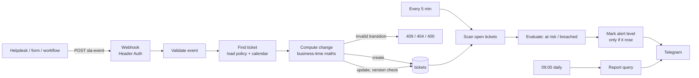

# Support SLA Engine for n8n: Business-Hours Clocks, Pause/Resume, Escalation and Daily Report

> Track first-response and resolution SLAs in **real business time** (time zone, working hours, weekends, holidays), stop the clock while you wait for the customer, get **one** alert when a ticket is at risk and one when it is breached, and see compliance per priority every morning. Works with any helpdesk that can call a webhook.


## Table of contents

1. [What it does](#what-it-does)
2. [Architecture](#architecture)
3. [How the clocks work](#how-the-clocks-work)
4. [Setup](#setup)
5. [API](#api)
6. [Configuration](#configuration)
7. [Database](#database)
8. [Security](#security)
9. [Testing](#testing)
10. [Troubleshooting](#troubleshooting)
11. [Limitations](#limitations)
12. [Roadmap](#roadmap)

## What it does

| Part | Behavior |
|---|---|
| **Business calendar** | One time zone (any IANA name), working days, opening hours and a holiday table. Every due date is computed in business minutes. |
| **SLA policies** | A first-response and a resolution target per priority. Defaults: urgent 15 min / 4 h (24x7), high 1 h / 8 h, normal 4 h / 40 h, low 8 h / 80 h (business time). |
| **Ticket events** | `created`, `first_response`, `pause`, `resume`, `resolve` through one authenticated webhook. |
| **Pause and resume** | While the ticket waits for the customer, both clocks stop and the remaining business minutes are saved. On resume the due times are recomputed from that moment. |
| **Escalation** | Every 5 minutes: a Telegram alert when 80 % of a target is used (at risk) and another when it is breached. Each alert is sent **once** per ticket and clock, even with several workers or manual runs. |
| **Daily report** | 09:00: open, waiting and breached tickets per priority, resolved in the last 24 h, resolution and first-response SLA percentages, average first response. |
| **Safe updates** | Optimistic locking: two events for the same ticket at the same time cannot corrupt it. The loser gets `409` and retries. |

## Architecture



## How the clocks work

### Business minutes

A due date is "N business minutes after now". The engine walks forward day by day: closed days (weekends, holidays) are skipped and only the minutes inside the opening hours are counted.

- Created Monday 10:00 with a 4 h target and 09:00-17:00 hours: due Monday 14:00.
- Created Friday 16:30 with a 60 min target: due Monday 09:30.
- Created Saturday: the clock starts Monday at opening time.
- The `24x7` policy (urgent by default) counts plain wall-clock minutes.

Daylight saving time and zones with half-hour offsets (India, Lord Howe) are handled by converting each day's opening and closing time through the zone rules, not by adding 24-hour blocks.

### Ticket states

```
            first_response (open only)
 open ─────────────────────────────┐
  │  ▲                             │ (stays open)
 pause│resume                      ▼
  ▼  │                          resolve ──► resolved
pending ───────── resolve ────────────────►
```

| Event | Allowed from | Effect |
|---|---|---|
| `created` | (new) | Both due dates computed. Sending it again returns `duplicate`. |
| `first_response` | open, no response yet | Records the time and whether the target was met. |
| `pause` | open | Saves remaining business minutes, clears due dates. |
| `resume` | pending | Recomputes due dates from now. |
| `resolve` | open or pending | Records whether the resolution target was met. A ticket resolved without any earlier response counts the resolution as its first response. |

Anything else answers `409` with the reason. A first response while the ticket is paused is refused on purpose: resume it first so the clock state is unambiguous.

### Alerts

For every open ticket and every running clock:

```
level 2 (breached)  : now >= due
level 1 (at risk)   : business minutes left <= 20 % of the target
```

The alert level is raised with `UPDATE ... WHERE level < new_level` and a message is sent only for rows that actually changed. Weekends do not count against you: on a Saturday a ticket due Monday 10:00 has 60 business minutes left, not 2 days.

## Setup

### Requirements

- n8n 1.x and PostgreSQL 13+
- A Telegram bot and the chat id of your support channel

### Steps

1. Run [`sql/schema.sql`](sql/schema.sql).
2. Set your calendar, holidays and targets (examples in [`sql/example_setup.sql`](sql/example_setup.sql)). The defaults are Monday to Friday, 09:00-17:00, `Asia/Jakarta`.
3. Import `workflows/support_sla_engine.json`.
4. Create credentials: Postgres, Telegram, and Header Auth named `SLA webhook key` (a long random value).
5. Replace `REPLACE_WITH_SUPPORT_CHAT_ID` (3 nodes) and the `REPLACE_ID` credential slots.
6. Set the **Error Workflow** in Workflow Settings to this workflow.
7. Send a test event (below), run *Manual Check*, then activate.

## API

`POST /webhook/sla-event` with your Header Auth key.

```bash
# New ticket
curl -X POST https://n8n.example.com/webhook/sla-event \
  -H "Authorization: <your key>" -H "Content-Type: application/json" \
  -d '{"type":"created","external_id":"HD-1042","subject":"Cannot log in","customer":"ACME","priority":"high","assignee":"Dewi"}'

# Agent answered
curl ... -d '{"type":"first_response","external_id":"HD-1042"}'
# Waiting for the customer / customer replied / done
curl ... -d '{"type":"pause","external_id":"HD-1042"}'
curl ... -d '{"type":"resume","external_id":"HD-1042"}'
curl ... -d '{"type":"resolve","external_id":"HD-1042"}'
```

| Status | Meaning |
|---|---|
| `200` | Applied (`created`, `duplicate` or `ok`). The body contains the new due dates. |
| `400` | Invalid input or unknown priority. |
| `404` | Unknown ticket. |
| `409` | Invalid transition, or the ticket changed at the same moment: read the message and retry if needed. |

The event is the source of truth for time: the engine uses the moment it receives the call. If your helpdesk delivers events late, call the webhook as soon as the action happens.

## Configuration

| Setting | Where | Default |
|---|---|---|
| Time zone, days, hours | `business_calendar` table | Asia/Jakarta, Mon-Fri, 09:00-17:00 |
| Holidays | `holidays` table | none |
| Targets and calendar type | `sla_policies` table | see above |
| Check frequency | *Check Schedule* | every 5 min |
| At-risk threshold | `WARN_AT` in *Evaluate SLAs* | 0.2 (20 % left) |
| Report time | *Report Schedule* | `0 9 * * *` |

Holidays are read for the next 400 days, so keep the table filled one year ahead.

## Database

| Table | Purpose |
|---|---|
| `business_calendar` | Single row: zone, working days, opening minutes |
| `holidays` | Closed days |
| `sla_policies` | Targets per priority, `business` or `24x7` |
| `tickets` | State, due dates, remaining minutes while paused, met flags, alert levels, `version` |

The table has CHECK constraints for the state machine: a resolved ticket has a resolution time, an open ticket always has a resolution due date, and a paused ticket has no due dates. A bug in the workflow cannot store an impossible state.

```sql
-- Breached right now
SELECT external_id, priority, subject FROM tickets
WHERE status = 'open' AND (response_alert_level = 2 OR resolution_alert_level = 2);

-- Compliance this month
SELECT priority, COUNT(*) AS resolved, ROUND(100.0 * COUNT(*) FILTER (WHERE resolution_met) / COUNT(*), 1) AS pct_met
FROM tickets WHERE resolved_at >= date_trunc('month', now()) GROUP BY priority;
```

## Security

- The event webhook requires Header Auth. Anyone with the key can create or change tickets, so keep it server-side.
- All text fields are length-limited, stripped of control characters and passed as query parameters. Subjects with quotes or SQL are stored as data.
- Telegram messages are HTML-escaped.
- Tickets contain customer names and subjects. Restrict database access and delete old tickets according to your retention policy.

## Testing

- **Calendar maths: 775 Code-node checks.** `bizMinutes` is compared with an independent brute-force reference that walks the interval minute by minute, on random intervals in 7 zones (Jakarta, Kolkata, New York, London, Los Angeles, Auckland and Lord Howe), around real DST changes, with weekends, custom working days, holidays and windows that cross a DST shift. `addBizMinutes` is checked by round trip (the business minutes between start and result equal the request, and one second earlier is not enough) and by exact examples (Friday afternoon rolls to Monday, boundaries, holidays). Plus event parsing, every state transition and rejection, the alert thresholds including exactly 20 % and weekend cases, and formatting.
- **SQL and full lifecycle: 58 checks on a real PostgreSQL engine (PGlite).** Constraints, then complete ticket lifecycles run through the shipped Code nodes and queries together (create, duplicate, pause, resume, first response, resolve, late resolve, holiday and weekend creation), optimistic-lock conflicts, exactly-once alerts, and the report query.

Not verified: a live n8n instance, Telegram, and concurrent execution of two real workers. The exactly-once alert guarantee rests on a single `UPDATE ... WHERE level < new_level`, which is tested sequentially.

## Troubleshooting

| Problem | Fix |
|---|---|
| `500 calendar misconfigured` | Invalid time zone name, empty working days or opening hours. Fix `business_calendar`. |
| Due dates look an hour off | Check `timezone` in `business_calendar`; the workflow's own timezone setting only affects schedules. |
| `409` on every call | The ticket state does not allow the event (for example `first_response` while paused). The message says which. |
| No alerts | The check workflow is inactive, or the Telegram credential or chat id is wrong. Run *Manual Check*. |
| Alerts for tickets that are fine | The ticket is open with a past due date. Resolve it, or pause it while waiting for the customer. |
| Report is empty | The report is skipped when there is nothing open, waiting or resolved in the last 24 h. |

## Limitations

- One calendar for all tickets (no per-customer or per-queue hours).
- Targets are per priority only (no per-customer-tier overrides).
- Reopening a resolved ticket is not supported; create a new one.
- Times are taken when the event arrives, not from a timestamp in the request.
- Escalation means alerts. Automatic reassignment is left to your helpdesk.

## Roadmap

- Per-queue calendars and customer-tier policies
- Reopen events and SLA history per ticket
- Escalation chain (agent, lead, manager) with different delays
- Optional event timestamp with a skew limit

## License

MIT. Add a `LICENSE` file to your repository.
